# WordPress SSO with Authentik (SAML)

In this lab I set up Authentik as the Identity Provider (IdP) for a WordPress site using SAML. The end result: a user clicks one button, logs in through Authentik, and lands in WordPress with an account created for them automatically.

## Tools Provided To Help Me Complete This Lab

- **WordPress**: the Service Provider (SP)
- **miniOrange SAML 2.0 SSO plugin**: adds SAML support to WordPress
- **Authentik**: the Identity Provider (IdP)

---

## 1. Install the SAML SSO Plugin in WordPress

From the WordPress dashboard I went to Plugins and installed **miniOrange SAML Single Sign On**. The plugin lets WordPress act as a SAML Service Provider, so it can trust an IdP like Authentik to log users in.

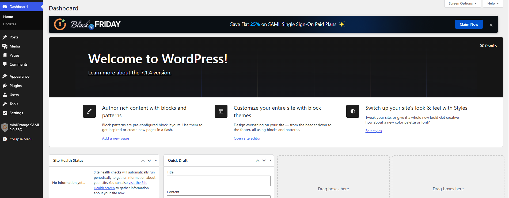
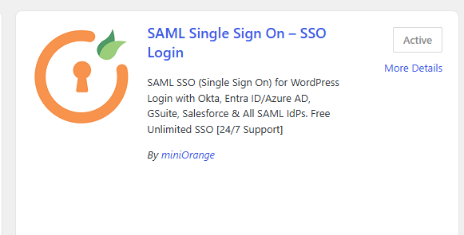
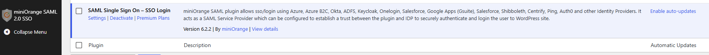

From the plugin I grabbed the two values Authentik needs:

| **SP Entity ID / Issuer** 
| **ACS (Assertion Consumer Service) URL** 

## 2. Create a SAML Provider in Authentik

In the Authentik admin panel I went to **Applications → Providers** and created a new **SAML Provider**. I pasted the ACS URL and Entity ID (Audience) from WordPress into the protocol settings.

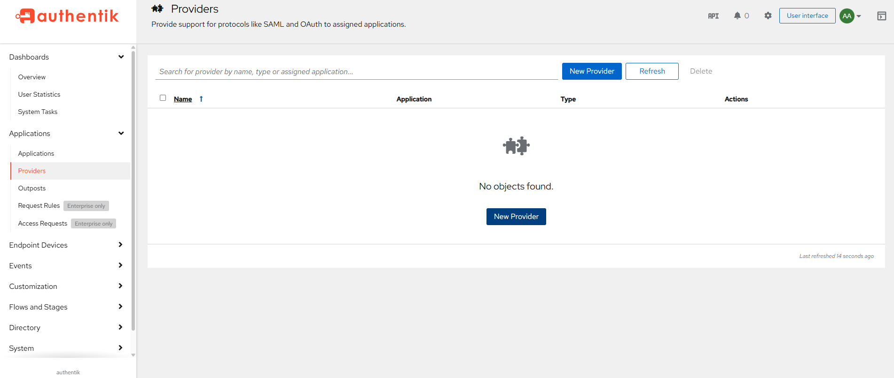
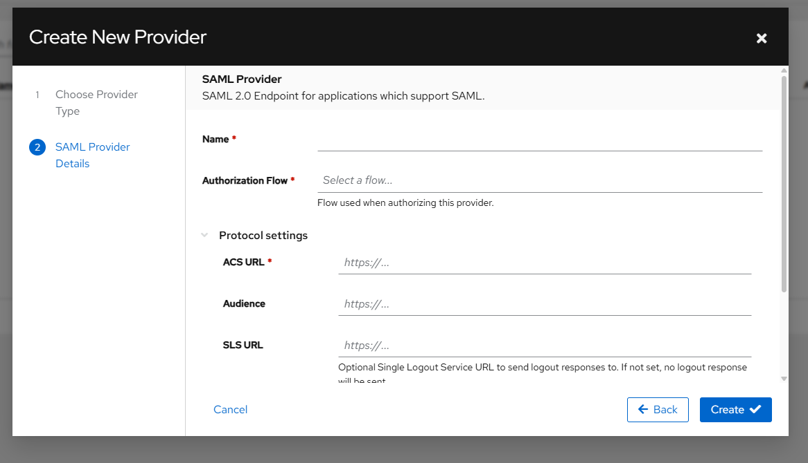
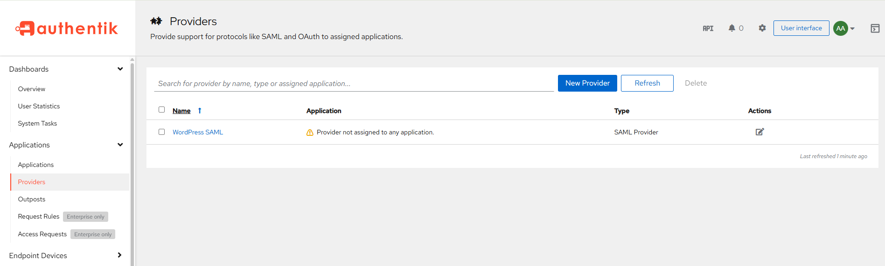

## 3. Create the WordPress Application in Authentik

Next I created an **Application** called WordPress and linked it to the SAML provider I just made.

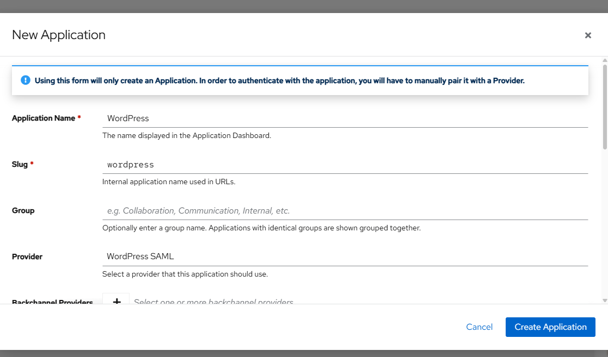
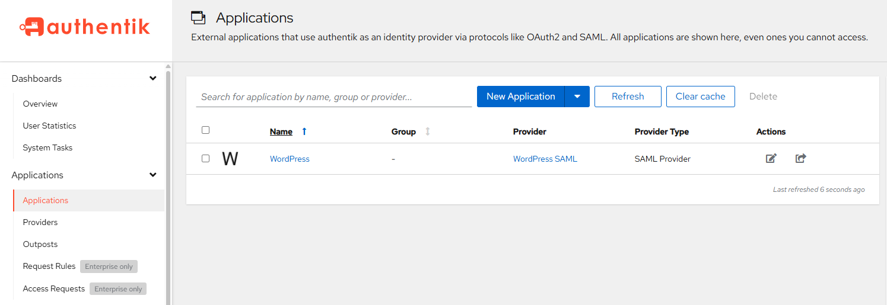

## 4. Upload the IdP Metadata to WordPress

Authentik isn't listed as a preset IdP in miniOrange, so I downloaded the provider's metadata from Authentik and uploaded it into the plugin instead. WordPress confirmed the IdP details were saved.

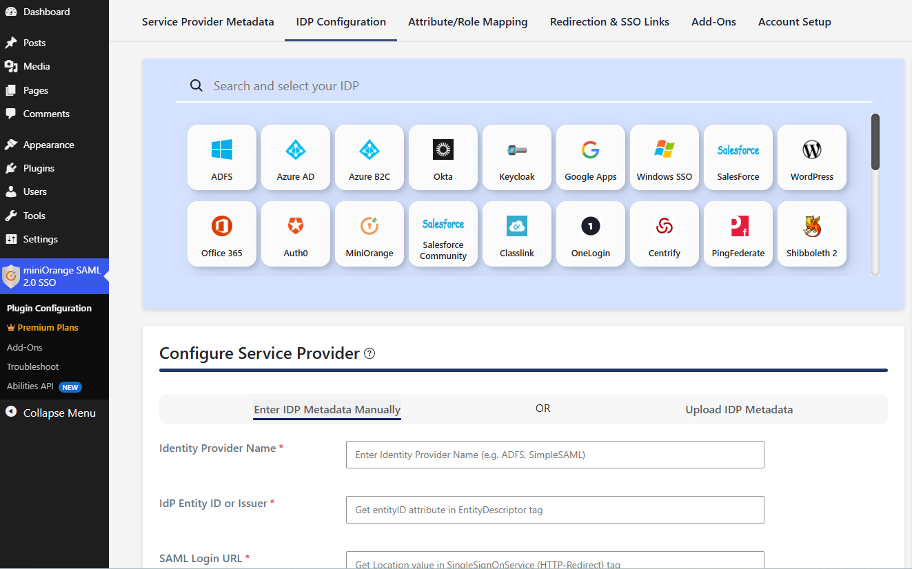
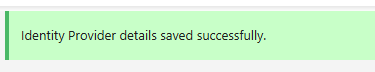

## 5. Create a Test User

With the IdP connected, I created a test user (`wp.tester`) in Authentik to try the login.

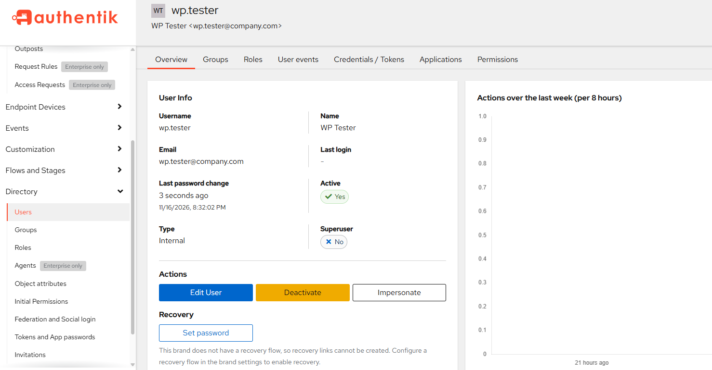

## 6. Add a Bind Policy

I bound the test user to the WordPress application so only approved users can open it. **Without a bind policy, Authentik lets every user access WordPress.**

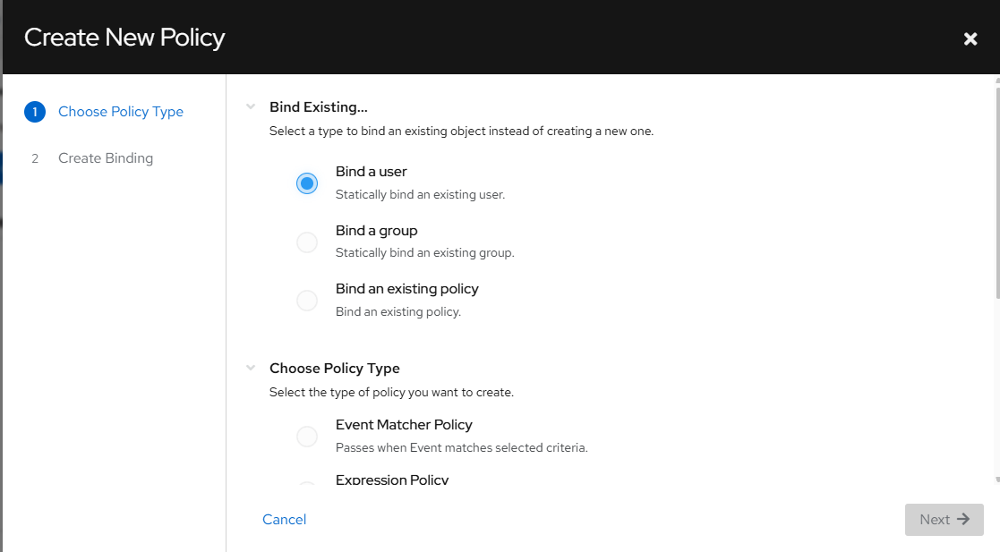
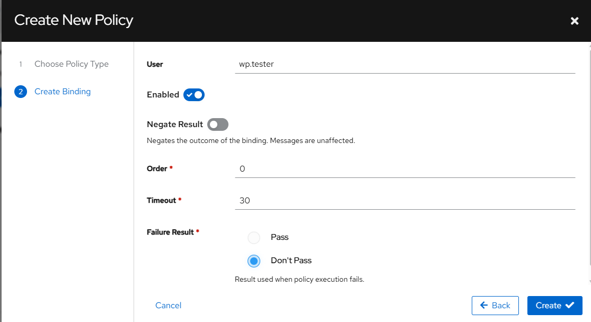
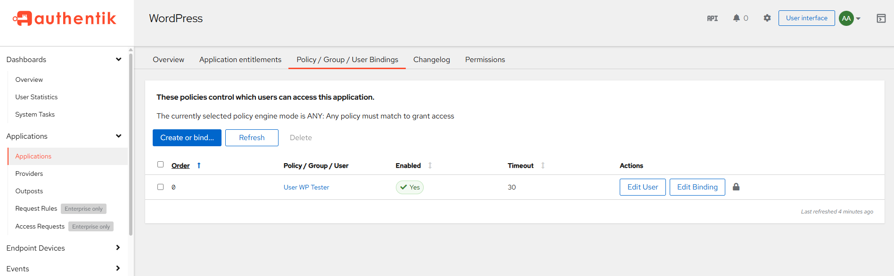

I also used the provider's **Preview** tab to check the SAML attributes Authentik sends for the test user (NameID, email, username, name, etc.).

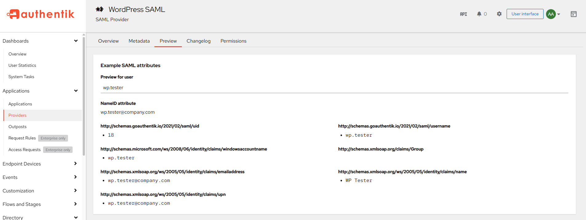

## 7. Test the Login

I logged in to Authentik as `wp.tester`, entered the MFA code, and saw WordPress on the user's app dashboard.

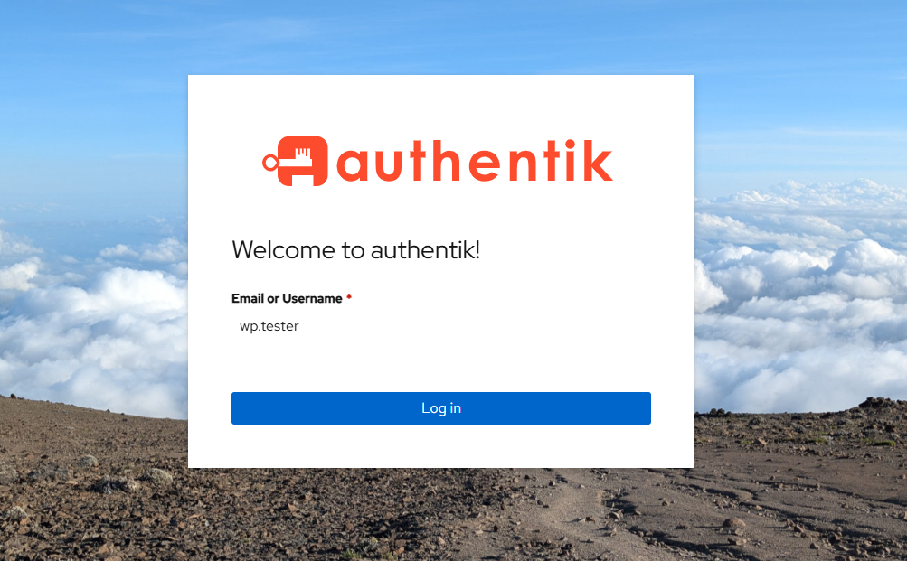
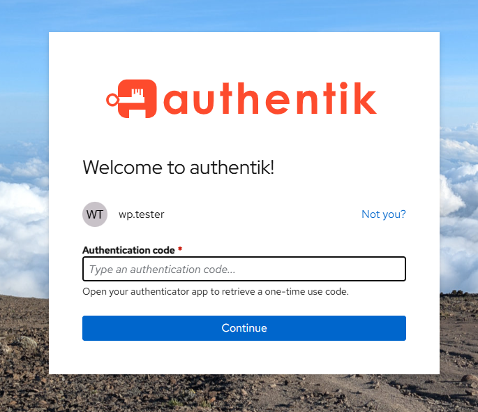
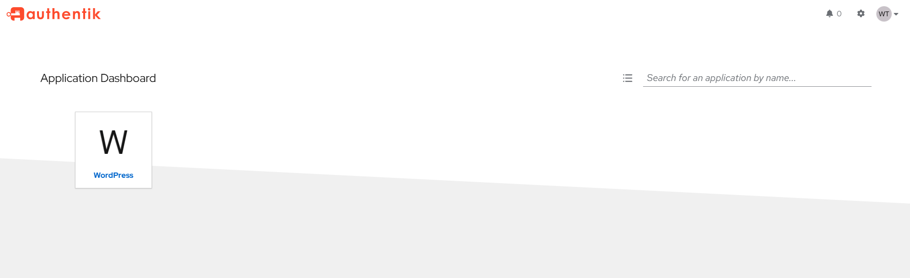

Clicking WordPress sent me through the SAML redirect. After I hit Continue, I landed on the WordPress Sample Page, already logged in.

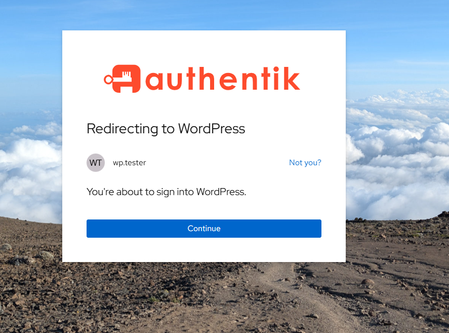

## 8. Verify the Account Was Created

I checked **Users** in the WordPress admin portal and confirmed the account was created automatically on first login.

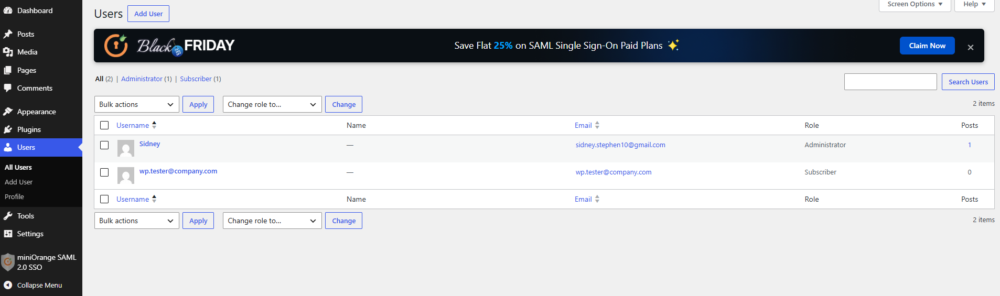

---

## Summary

I connected Authentik to WordPress with SAML SSO. Once it was in place, one click logs a user in and automatically creates their WordPress account. I used a bind policy so only the users I choose can access the app.
